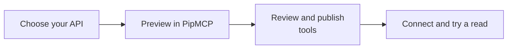

# Give an older documented business system a reviewed setup path

**Your own software + your AI assistant · powered by PipMCP**

You already have an older Swagger description for a system your organization is allowed to use, and want help turning it into a controlled connection.

**Made for:** Business owners bringing an existing internal tool to an assistant

For real use, you will need PipMCP and an API you are allowed to connect.

## Ask your AI to set this up

Paste this into a coding assistant that can open project files and run commands, such as Codex, Claude Code or Grok Build. You do not need to understand the code first.

```text
Help me use this project: https://github.com/jannikco/swagger-to-mcp

I'm not a programmer. My goal is: Give an older documented business system a reviewed
setup path.

Read the project instructions and set it up in a new folder without overwriting my work.
Guide me through PipMCP and its private key setup; never ask me to paste secrets into this
chat. Show the documented preview first. Explain what would be uploaded before asking me
to confirm an import. Explain the result in plain English. Ask before changing records,
sending messages or publishing anything.
```

## Three useful things to ask for

```text
Help me understand an older Swagger description that I am authorized to use. Explain which
business actions it describes.
```

```text
Prepare an import plan in PipMCP and show the selected actions, account requirements and
changes for my review. Do not import or publish automatically.
```

```text
After I approve the import, help me configure the connection and verify one non-changing
action. Do not treat an import receipt as proof that the service works.
```

## Your path to a real result



1. [Open PipMCP](https://pipmcp.com/github/start?integration=swagger-to-mcp&utm_source=github&utm_campaign=github-swagger-to-mcp&utm_content=people-first-readme) and choose the API definition you control.
2. Preview the import, then review and publish the selected tools in your private workspace.
3. Configure its authorized connection and a PipMCP API key, then ask your AI to discover an appropriate read.

**What to expect:** You get a reviewed import path into private PipMCP. A PipMCP key is required for real imports. Importing, publishing the chosen actions and connecting the account are separate steps; access must be verified afterward.

Add your PipMCP key privately in your project settings. Keep keys out of chat and public repositories.

## Keep going

- [Find another useful integration](https://github.com/jannikco/pipmcp-connectors)
- [Connect an API you control](https://github.com/jannikco/openapi-to-mcp)
- [Try the GitHub project](https://github.com/jannikco/github-mcp)

<details>
<summary>Technical reference: installation commands, exact capabilities and troubleshooting</summary>

<!-- people-first:technical:start -->
# Swagger to MCP import starter

**Turn your swagger API definition into hosted MCP tools. Preview locally, then explicitly import it with your PipMCP API key.**

[Activate with PipMCP](https://pipmcp.com/github/start?integration=swagger-to-mcp&utm_source=github&utm_campaign=github-swagger-to-mcp) · [Integration directory](https://jannikco.github.io/pipmcp-connectors/guides/swagger-to-mcp/)

## Build something useful

Preview and explicitly upload a reviewed API definition. In PipMCP, inspect and publish the selected tools within your workspace, configure an authorized connection, and keep the returned integration ID. Draft imports have no callable inventory.

The package is an authenticated client: discovery, schemas, policy decisions and execution come from PipMCP. Provider implementation remains on the server.

## Quick start

Requires Node.js 22+. Clone this repository, then:

```sh
npm ci --ignore-scripts
npm test
node example.mjs
# Review your file before explicitly uploading:
node example.mjs ./your-api.json --name "My private API" --execute --confirm-import
```

Create a PipMCP API key with explicit connectors:read and connectors:call scopes. Importing additionally requires integrations:read and integrations:write on that same key; input upload requires explicit --execute --confirm-import. It creates a private integration only.Set PIPMCP_API_KEY in the calling process environment. Provider credentials are configured in PipMCP. For custom-api discovery and the stdio server, PIPMCP_INTEGRATION_ID is required; select the reviewed, published integration, not an uninspected draft. Multiple accounts require explicit PIPMCP_INTEGRATION_ID and PIPMCP_CONNECTION_ID from discovery. Existing keys do not gain scopes automatically.

## Built for coding agents

Install this repository's skill into your project:

```sh
node lib/cli.mjs agents install --client codex --scope project --project /path/to/project
# Use claude or grok for those clients.
```

Import a reviewed swagger API definition into private PipMCP and connect its tools to AI agents. Native AGENTS.md, CLAUDE.md and project skills support the current coding session. No additional AI model key is required. [capabilities.json](capabilities.json) describes the package; [llms.txt](llms.txt) indexes its instructions.

## Inspect actual tools before calling

```js
import {PipMCPGatewayClient} from './lib/index.mjs';
const client = new PipMCPGatewayClient(); // PIPMCP_API_KEY
const inventory = await client.getTools("custom-api", {integrationId: process.env.PIPMCP_INTEGRATION_ID});
console.log(inventory.data.tools);
// Select a real tool and validate your arguments against its returned schema.
// client.callTool(provider, actualToolName, reviewedArguments, {idempotencyKey});
```

PipMCP enforces workspace, role, connection, policy/approval and usage controls. Preserve the original idempotency key when retrieving/resuming a receipt. Pending and confirmation_required are not completed provider results; uncertain writes are held for reconciliation. The bridge never auto-approves a hosted action.

## Version 1 migration

This release uses the authenticated PipMCP gateway for real discovery/execution. Upgrade your MCP launch command and configure PIPMCP_API_KEY before reconnecting. Historical local runtimes remain available under their original MIT license in Git history. The historical local compiler is replaced by an authenticated private import workflow.

## Evidence and support

Transport, package and agent fixtures are tested. Authentication/provider access must be checked in your own configured workspace; synthetic fixtures do not establish live provider execution. Do not include credentials or customer records in public issues. MIT covers this public client.

<!-- people-first:technical:end -->

</details>
